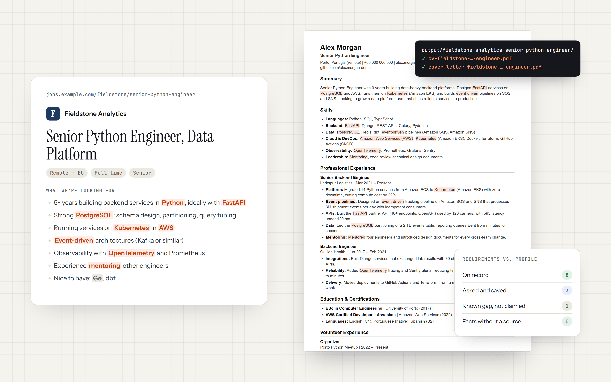
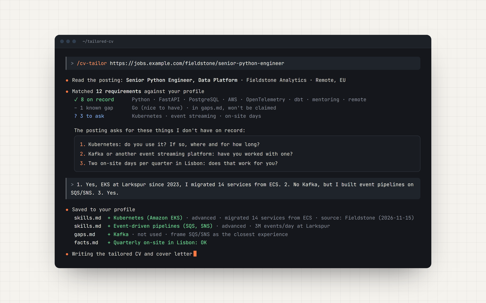
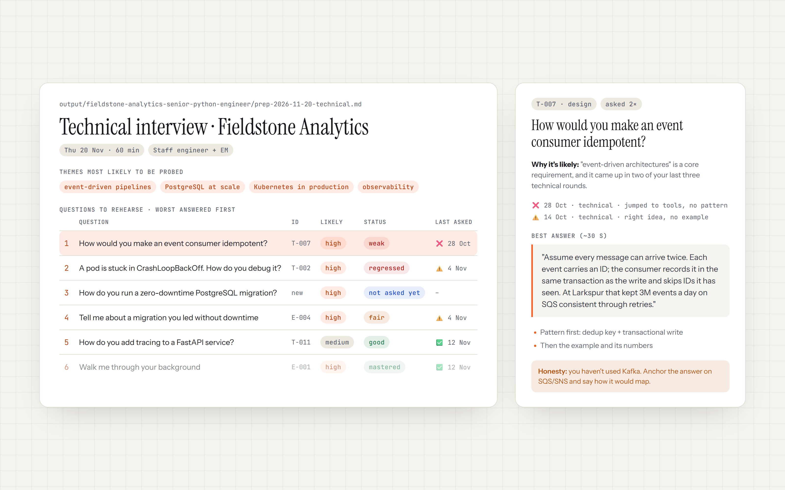

# tailored-cv

[English](README.md) · **Español**

[](https://github.com/theviderlab/tailored-cv/actions/workflows/build.yml)
[](https://github.com/theviderlab/tailored-cv/releases)
[](LICENSE)
[](https://nodejs.org)
[](https://docs.claude.com/en/docs/claude-code)
[](https://opencode.ai)

**Un flujo de trabajo con agentes de IA para buscar empleo: adapta tu CV y tu carta de presentación a cada oferta, genera PDFs optimizados para ATS y analiza tus entrevistas, a partir de un perfil que crece con cada candidatura y nunca inventa datos.**

Pega el enlace de una oferta. El agente la lee, la compara con tu perfil profesional, te pregunta solo lo que no sabe y escribe un CV y una carta para esa oferta, listos para enviar en PDF.



**[Web del proyecto](https://viderlab.com/proyectos/tailored-cv/)** · [Primeros pasos](#primeros-pasos) · [Ver una demo](examples/alex-morgan/) · [Discussions](https://github.com/theviderlab/tailored-cv/discussions)

> Las skills te hablan en tu idioma, así que puedes usarlas en español. Los archivos del proyecto (skills, perfil, documentación técnica) están en inglés; este README es la traducción de [README.md](README.md), que es la versión de referencia.

## Contenido

- [Por qué tailored-cv](#por-qué-tailored-cv)
- [Funcionalidades](#funcionalidades)
- [Primeros pasos](#primeros-pasos)
- [Demo](#demo)
- [Adaptar un CV](#adaptar-un-cv)
- [Análisis de entrevistas](#análisis-de-entrevistas-opcional-windows)
- [Tu workspace](#tu-workspace)
- [Privacidad](#privacidad)
- [Generar los PDFs a mano](#generar-los-pdfs-a-mano)
- [Idiomas](#idiomas)
- [Limitaciones](#limitaciones)
- [Contribuir](#contribuir)
- [Licencia](#licencia)

## Por qué tailored-cv

La mayoría de las herramientas de CV con IA reescriben tu CV a partir de un prompt y rellenan los huecos con ficción verosímil. tailored-cv funciona al revés:

- **Sin datos inventados.** Cada línea del CV sale de tu perfil o de algo que confirmaste. Cuando una oferta pide algo que no está registrado, el agente te pregunta en lugar de suponer.
- **Un perfil que se acumula.** Cada respuesta se guarda en tu perfil con su fuente y su fecha, así que la siguiente candidatura empieza con más evidencia y menos preguntas.
- **Pensado para ATS.** Diseño de una columna, texto real, encabezados estándar y las palabras clave de la oferta, siguiendo las reglas de [docs/ats-guidelines.md](docs/ats-guidelines.md).
- **Tus datos son tuyos.** Tu perfil, tus CVs y tus candidaturas viven en la carpeta `workspace/`, ignorada por git. El audio de las entrevistas se transcribe en tu ordenador.
- **Archivos planos.** Entra Markdown, sale PDF. Sin cuentas ni base de datos: todo se puede leer, editar y versionar.

## Funcionalidades

| Skill | Qué hace |
|---|---|
| **`cv-tailor`** | Lee una oferta (enlace o texto pegado), la compara con tu perfil, te pregunta lo que falta, escribe el CV y la carta adaptados, te muestra qué cambió y de dónde sale cada dato, genera los PDFs y registra la candidatura. |
| **`profile-audit`** | Revisa tu perfil según las buenas prácticas de ATS (fechas sin mes, logros sin métricas, siglas sin su forma completa, duplicados…) y te pregunta lo necesario para corregirlo. |
| **`interview`** | Graba una entrevista online, la transcribe en local con Whisper, revisa tus respuestas contra tu perfil y mantiene un banco de preguntas para preparar las siguientes entrevistas. |

Estructura del repositorio:

```
.claude/skills/        Skills cv-tailor, profile-audit e interview
cv/                    Build de Markdown a PDF (Node + Chrome/Edge headless)
docs/                  Reglas ATS que aplican las skills
tools/                 Grabador y transcriptor de entrevistas, en local (Python)
examples/              Workspace de demo ficticio (Alex Morgan)
workspace.example/     Plantilla vacía para tu workspace personal
workspace/             Tus datos (ignorado por git; se crea en el primer uso)
```

## Primeros pasos

**Requisitos:** [Node.js](https://nodejs.org) 18+, Google Chrome o Microsoft Edge, y un agente de IA para programar: [Claude Code](https://docs.claude.com/en/docs/claude-code) u [OpenCode](https://opencode.ai). En Windows el build encuentra Chrome o Edge solo; en macOS o Linux, define `CHROME_PATH` con la ruta al ejecutable del navegador.

```sh
git clone https://github.com/theviderlab/tailored-cv.git
cd tailored-cv
cp -r workspace.example workspace
cd cv && npm install
```

Abre la carpeta del proyecto en tu agente y empieza con alguna de estas:

- *"Arma mi perfil a partir de este CV"* y pega tu CV actual.
- *"Adapta mi CV a esta oferta: &lt;enlace&gt;"*. Si `workspace/` todavía no existe, la skill lo crea desde la plantilla y te guía.

**Claude Code** carga las skills de `.claude/skills/` y te deja invocarlas directamente (`/cv-tailor`, `/profile-audit`, `/interview`). **OpenCode** carga las mismas skills: pídelo con tus palabras (*"adapta mi CV a…"*) y usará la que corresponda.

## Demo

[`examples/alex-morgan/`](examples/alex-morgan/) es un workspace completo y ficticio: un perfil, una oferta y el CV y la carta adaptados a ella, en markdown y en PDF. Es la misma candidatura que aparece en las capturas. Léelo para ver qué produce la herramienta, o cópialo a `workspace/` para probar las skills antes de cargar tus datos.

## Adaptar un CV

```
/cv-tailor https://www.linkedin.com/jobs/view/1234567890
```

El agente entonces:

1. **Lee la oferta.** Si no puede descargar el enlace (por ejemplo, si pide iniciar sesión), te pide que pegues el texto.
2. **La compara con tu perfil** y clasifica cada requisito: ya registrado, carencia conocida o desconocido.
3. **Te pregunta por los desconocidos** en un solo mensaje (p. ej. *"La oferta pide Kubernetes, ¿lo usas?"*) y guarda tus respuestas en el perfil.
4. **Escribe el CV y la carta adaptados**, te muestra qué cambió y de dónde sale cada dato, y genera los PDFs cuando das el visto bueno.
5. **Registra la candidatura** en `workspace/applications.md`.



Cada oferta tiene su propia carpeta:

```
workspace/output/<empresa>-<puesto>/
├── cv-<empresa>-<puesto>.md
├── cv-<empresa>-<puesto>.pdf
├── cover-letter-<empresa>-<puesto>.md
└── cover-letter-<empresa>-<puesto>.pdf
```

Otras cosas que puedes pedir:

- *"Pasa la candidatura de Acme a entrevista"*
- *"Agrega a mi perfil que uso Terraform"*
- `/profile-audit` para pulir el perfil para ATS sin una oferta concreta

## Análisis de entrevistas (opcional, Windows)

Cuando empiezan las entrevistas, la skill `interview` graba la llamada (tu micrófono y el audio de la llamada en pistas separadas), la transcribe **en tu ordenador** con Whisper y escribe una revisión: las preguntas que te hicieron, cómo respondiste, mejores respuestas construidas desde tu perfil y lo que aprendiste del puesto.

```
/interview start acme technical     # antes de la llamada
/interview stop                     # después: transcribe y revisa
```

Requiere [uv](https://docs.astral.sh/uv/); con una GPU NVIDIA la transcripción va más rápido. Más detalles en [tools/interview-recorder/README.md](tools/interview-recorder/README.md).

> **Pide consentimiento antes de grabar.** Grabar una llamada sin el consentimiento de la otra parte es ilegal en muchos países y estados. Avisa a tus entrevistadores de que estás grabando y detén la grabación si se oponen. Cumplir las leyes que te aplican es tu responsabilidad.

### Banco de preguntas

Los entrevistadores hacen las mismas pocas preguntas con distintas palabras, así que cada revisión alimenta también `workspace/interview-bank/`: preguntas agrupadas por lo que evalúan (experiencia o técnicas), cada una con el historial de cómo la respondiste (✅ bien, ⚠️ regular, ❌ mal), un estado que da más peso a tus últimas respuestas y la mejor respuesta hasta ahora. Los temas no están predefinidos: surgen de tus propias entrevistas.

Antes de la siguiente entrevista:

```
/interview prep acme technical
```

El agente compara la oferta con el banco, estima qué preguntas son más probables para ese puesto y esa etapa, agrega preguntas probables que todavía no te hicieron y escribe una hoja de preparación que pone primero las que peor respondes. Una transcripción o revisión pegada desde otro sitio (p. ej. la transcripción de Teams) también alimenta el banco, así que funciona sin el grabador.



## Tu workspace

### Perfil (`workspace/profile/`)

El perfil es la fuente de verdad de la que salen los CVs. No hace falta completarlo de entrada: **crece con el tiempo** a partir de tu CV inicial, de las respuestas que das en cada candidatura y de lo que le cuentes al agente. Cada entrada registra de dónde salió y cuándo.

| Archivo | Qué guarda |
|---|---|
| `skills.md` | Habilidades técnicas y de gestión, con nivel y evidencia |
| `experience.md` | Banco de logros por puesto (más de los que caben en un CV) |
| `projects.md` | Proyectos, charlas y trabajo en comunidad |
| `education.md` | Títulos, certificaciones e idiomas |
| `stories.md` | Anécdotas y argumentos reutilizables para cartas |
| `facts.md` | Datos prácticos: contacto, ubicación, disponibilidad, respuestas a formularios |
| `gaps.md` | Lo que confirmaste que **no** sabes o no quieres destacar, para que no se vuelva a preguntar |
| `audit.md` | Estado de la auditoría ATS: pendientes, resueltos y descartados |

`workspace/cv-base.md` y `workspace/cover-letter-base.md` son la selección por defecto (hasta dos páginas) de la que parte cada candidatura. El perfil puede guardar mucho más de lo que cabe en un CV.

### Registro de candidaturas (`workspace/applications.md`)

Una fila por candidatura, la más reciente primero: fecha, empresa, puesto, carpeta, enlace a la oferta, estado y notas. `cv-tailor` agrega la fila al generar los PDFs; el estado lo actualizas tú o se lo pides al agente.

| Estado | Significado |
|---|---|
| `?` | PDFs generados, envío sin confirmar |
| `sent` | Candidatura enviada |
| `interview` | En proceso de entrevistas |
| `offer` | Oferta recibida |
| `rejected` | Rechazada |
| `dropped` | Decidiste no enviarla |

El registro también permite que el agente te avise si ya te postulaste a una empresa, y que sugiera actualizar el CV base cuando el mismo agregado se repite en varias candidaturas.

### Copia de seguridad de tus datos (recomendado)

`workspace/` queda fuera de este repo, así que puedes versionarlo como un repo **privado** aparte:

```sh
cd workspace
git init
git add .
git commit -m "Initial profile"
gh repo create <tu-usuario>/tailored-cv-workspace --private --source . --push
```

A partir de ahí, los cambios de la herramienta se commitean en la raíz y los de tus datos dentro de `workspace/`.

## Privacidad

- **Qué se queda en tu ordenador:** los archivos de tu workspace y el audio de las entrevistas. La transcripción es local.
- **Qué llega al modelo de IA:** el texto de la oferta, las partes de tu perfil que lee el agente y las transcripciones de entrevistas, que se envían al proveedor del modelo que tenga configurado tu agente. Revisa su política de datos.
- **Protección contra filtraciones:** si haces un fork o contribuyes, el hook `.githooks/pre-commit` bloquea cualquier commit que incluya archivos de `workspace/` o texto que coincida con los patrones de `workspace/.private-patterns` (tu nombre, email, teléfono…; uno por línea). Actívalo una vez por clon:

  ```sh
  git config core.hooksPath .githooks
  ```

## Generar los PDFs a mano

```sh
cd cv
npm run cv -- ../workspace/cv-base.md
npm run cover -- ../workspace/cover-letter-base.md
```

## Idiomas

Las skills te hablan en tu idioma. El perfil se guarda en inglés y el contenido del CV sigue el idioma de la oferta. Para un CV o una carta en otro idioma, empieza el markdown con front matter:

```markdown
---
lang: es
---
```

Los encabezados de las secciones del PDF salen de [cv/i18n.json](cv/i18n.json), donde se pueden agregar más idiomas.

## Limitaciones

- La grabación de entrevistas solo funciona en Windows. La transcripción y las revisiones funcionan en cualquier sistema, también a partir de transcripciones pegadas.
- Algunos portales de empleo (LinkedIn, entre otros) bloquean la descarga automática; en ese caso pega el texto de la oferta.
- Los PDFs usan una sola plantilla, pensada para ATS.
- La calidad de la adaptación depende del modelo que use tu agente y de lo completo que esté tu perfil.

## Contribuir

Issues, ideas y pull requests son bienvenidos; en [CONTRIBUTING.md](CONTRIBUTING.md) está cómo preparar el entorno, cómo probar los cambios y cómo agregar un idioma. Para preguntas e ideas, usa [Discussions](https://github.com/theviderlab/tailored-cv/discussions). Para reportar un problema de seguridad o privacidad, sigue [SECURITY.md](SECURITY.md). Los cambios de cada versión están en [CHANGELOG.md](CHANGELOG.md).

## Licencia

[MIT](LICENSE)
