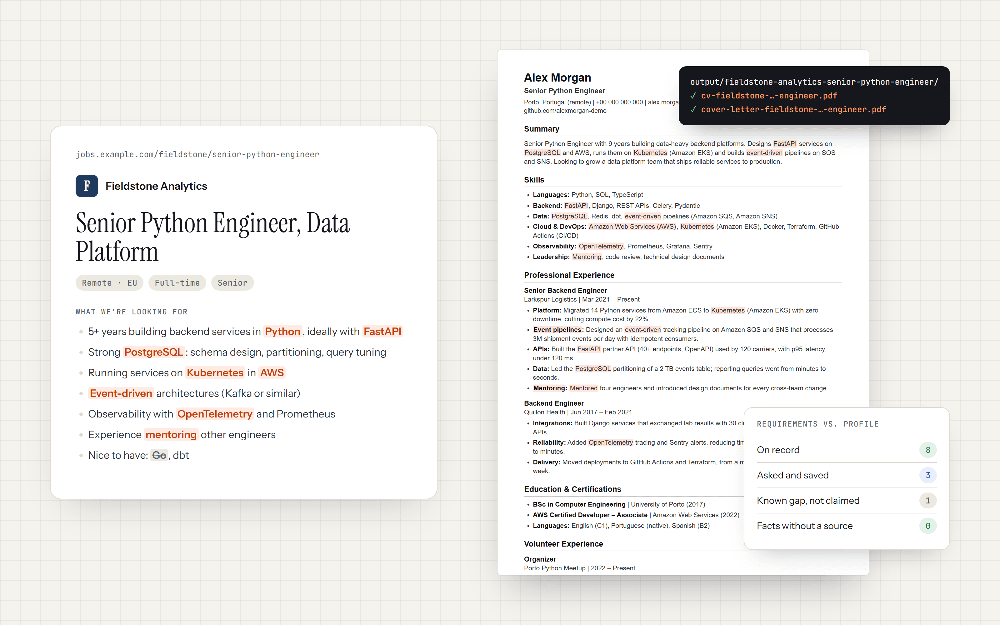
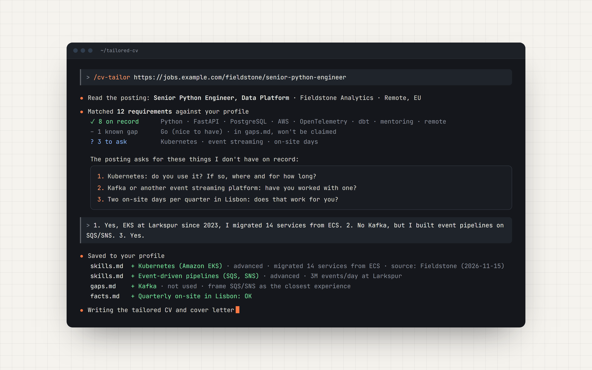
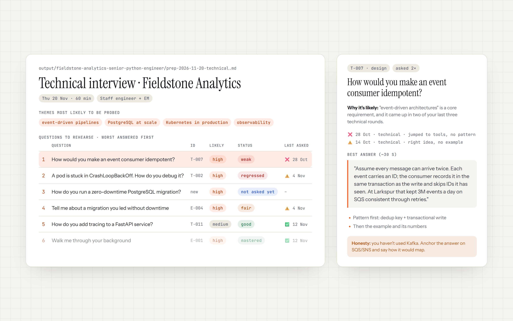

# tailored-cv

**English** · [Español](README.es.md)

[](https://github.com/theviderlab/tailored-cv/actions/workflows/build.yml)
[](https://github.com/theviderlab/tailored-cv/releases)
[](LICENSE)
[](https://nodejs.org)
[](https://docs.claude.com/en/docs/claude-code)
[](https://opencode.ai)

**An AI agent workflow for job applications: tailor your CV and cover letter to each posting, generate ATS-optimized PDFs, and debrief your interviews — from a profile that grows with every application and never invents data.**

Paste a job posting link. The agent reads it, matches it against your professional profile, asks you only about what it doesn't know, and writes a CV and cover letter for that posting, ready to send as PDFs.



**[Project website](https://viderlab.com/en/projects/tailored-cv/)** · [Getting started](#getting-started) · [See a demo](examples/alex-morgan/) · [Discussions](https://github.com/theviderlab/tailored-cv/discussions)

## Contents

- [Why tailored-cv](#why-tailored-cv)
- [Features](#features)
- [Getting started](#getting-started)
- [Demo](#demo)
- [Tailoring a CV](#tailoring-a-cv)
- [Interview debriefs](#interview-debriefs-optional-windows)
- [Your workspace](#your-workspace)
- [Privacy](#privacy)
- [Building PDFs by hand](#building-pdfs-by-hand)
- [Languages](#languages)
- [Limitations](#limitations)
- [Contributing](#contributing)
- [License](#license)

## Why tailored-cv

Most AI CV tools rewrite your CV from a prompt and happily fill the gaps with plausible fiction. tailored-cv works the other way around:

- **No invented facts.** Every line in a CV traces back to your profile or to something you confirmed. When a posting asks for something that is not on record, the agent asks you instead of guessing.
- **A profile that compounds.** Each answer is saved to your profile with its source and date, so the next application starts with more evidence and fewer questions.
- **Built for ATS.** Single-column layout, real text, standard headings and keywords taken from the posting, following the rules in [docs/ats-guidelines.md](docs/ats-guidelines.md).
- **Your data stays yours.** Your profile, CVs and applications live in a git-ignored `workspace/` folder. Interview audio is transcribed on your machine.
- **Plain files.** Markdown in, PDF out. No accounts and no database: everything can be read, edited and versioned.

## Features

| Skill | What it does |
|---|---|
| **`cv-tailor`** | Reads a posting (link or pasted text), compares it with your profile, asks you about anything missing, writes the tailored CV and cover letter, shows what changed and where each fact comes from, builds the PDFs and logs the application. |
| **`profile-audit`** | Reviews your profile against ATS best practices (dates without months, bullets without metrics, acronyms without their full form, duplicates…) and asks you what is needed to fix it. |
| **`interview`** | Records an online interview, transcribes it locally with Whisper, reviews your answers against your profile and keeps a question bank to prepare the next interviews. |

Repository layout:

```
.claude/skills/        cv-tailor, profile-audit and interview skills
cv/                    Markdown → PDF build (Node + headless Chrome/Edge)
docs/                  ATS guidelines the skills apply
tools/                 Local interview recorder and transcriber (Python)
examples/              Fictional demo workspace (Alex Morgan)
workspace.example/     Empty template for your personal workspace
workspace/             Your data (git-ignored; created on first use)
```

## Getting started

**Requirements:** [Node.js](https://nodejs.org) 18+, Google Chrome or Microsoft Edge, and an AI coding agent: [Claude Code](https://docs.claude.com/en/docs/claude-code) or [OpenCode](https://opencode.ai). The build finds Chrome or Edge on its own on Windows; on macOS or Linux, set `CHROME_PATH` to the browser's executable.

```sh
git clone https://github.com/theviderlab/tailored-cv.git
cd tailored-cv
cp -r workspace.example workspace
cd cv && npm install
```

Open the project folder in your agent and start with one of these:

- *"Build my profile from this CV"*, then paste your current CV.
- *"Tailor my CV to this posting: &lt;link&gt;"*. If `workspace/` does not exist yet, the skill creates it from the template and guides you.

**Claude Code** picks up the skills from `.claude/skills/` and lets you call them directly (`/cv-tailor`, `/profile-audit`, `/interview`). **OpenCode** loads the same skills, so ask in plain language (*"tailor my CV to…"*) and it will use the right one.

## Demo

[`examples/alex-morgan/`](examples/alex-morgan/) is a complete, fictional workspace: a profile, a job posting, and the CV and cover letter tailored to it, as markdown and PDF. It is the same application shown in the screenshots. Read it to see what the tool produces, or copy it to `workspace/` to try the skills before entering your own data.

## Tailoring a CV

```
/cv-tailor https://www.linkedin.com/jobs/view/1234567890
```

The agent then:

1. **Reads the posting.** If the link cannot be fetched (login walls, for example), it asks you to paste the text.
2. **Compares it with your profile** and sorts each requirement into: already on record, known gap, or unknown.
3. **Asks you about the unknowns** in a single message (e.g. *"The posting asks for Kubernetes — do you use it?"*) and saves your answers to the profile.
4. **Writes the tailored CV and cover letter**, shows you what changed and where each fact comes from, and builds the PDFs once you approve.
5. **Logs the application** in `workspace/applications.md`.



Each posting gets its own folder:

```
workspace/output/<company>-<role>/
├── cv-<company>-<role>.md
├── cv-<company>-<role>.pdf
├── cover-letter-<company>-<role>.md
└── cover-letter-<company>-<role>.pdf
```

Other things you can ask:

- *"Update the Acme application to interview"*
- *"Add to my profile that I use Terraform"*
- `/profile-audit` to polish the profile for ATS without a specific posting

## Interview debriefs (optional, Windows)

Once interviews start, the `interview` skill records the call (your microphone and the call audio on separate tracks), transcribes it **on your machine** with Whisper and writes a review: the questions you were asked, how you answered, better answers built from your profile, and what you learned about the role.

```
/interview start acme technical     # before the call
/interview stop                     # after it: transcribe + review
```

Requires [uv](https://docs.astral.sh/uv/); an NVIDIA GPU makes transcription faster. See [tools/interview-recorder/README.md](tools/interview-recorder/README.md).

> **Get consent before recording.** Recording a call without the other party's consent is illegal in many countries and states. Tell your interviewers you are recording and stop if they object. You are responsible for complying with the laws that apply to you.

### Question bank

Interviewers ask the same handful of questions with different wording, so every review also feeds `workspace/interview-bank/`: questions grouped by what they test (experience or technical), each with the history of how you answered it (✅ good, ⚠️ fair, ❌ poor), a status that weighs your latest answers most, and the best answer so far. The themes are not predefined; they grow out of your own interviews.

Before the next interview:

```
/interview prep acme technical
```

The agent matches the posting against the bank, estimates which questions are most likely for that role and stage, adds likely questions you have not been asked yet, and writes a prep sheet that puts the questions you answer worst first. A transcript or review pasted from elsewhere (e.g. Teams' transcription) feeds the bank too, so this works without the recorder.



## Your workspace

### Profile (`workspace/profile/`)

The profile is the source of truth the CVs are built from. You don't have to fill it in upfront: it **grows over time** from your initial CV, the answers you give on each application, and anything you tell the agent directly. Every entry records where it came from and when.

| File | What it stores |
|---|---|
| `skills.md` | Technical and management skills, with level and evidence |
| `experience.md` | Achievement bank per role (more bullets than fit in a CV) |
| `projects.md` | Projects, talks and community work |
| `education.md` | Degrees, certifications and languages |
| `stories.md` | Reusable anecdotes and arguments for cover letters |
| `facts.md` | Practical data: contact, location, availability, answers to application forms |
| `gaps.md` | What you confirmed you do **not** know or don't want to highlight, so it is not asked again |
| `audit.md` | State of the ATS audit: pending, resolved and dismissed items |

`workspace/cv-base.md` and `workspace/cover-letter-base.md` are the default selection (up to two pages) that each application starts from. The profile can hold much more than fits in a CV.

### Application log (`workspace/applications.md`)

One row per application, most recent first: date, company, role, output folder, posting link, status and notes. `cv-tailor` adds the row when it builds the PDFs; you update the status yourself or by asking the agent.

| Status | Meaning |
|---|---|
| `?` | PDFs generated, sending not confirmed yet |
| `sent` | Application sent |
| `interview` | In the interview process |
| `offer` | Offer received |
| `rejected` | Rejected |
| `dropped` | Decided not to send it |

The log also lets the agent warn you when you already applied to a company, and suggest updating the base CV when the same addition keeps showing up across applications.

### Backing up your data (recommended)

`workspace/` stays out of this repo, so version it as a separate **private** repo:

```sh
cd workspace
git init
git add .
git commit -m "Initial profile"
gh repo create <your-user>/tailored-cv-workspace --private --source . --push
```

From then on, changes to the tool are committed at the root and changes to your data inside `workspace/`.

## Privacy

- **What stays on your machine:** your workspace files and the interview audio. Transcription runs locally.
- **What reaches the AI model:** the posting text, the parts of your profile the agent reads, and interview transcripts, all sent to whichever model provider your agent is configured with. Review that provider's data policy.
- **Leak protection:** if you fork or contribute, the `.githooks/pre-commit` hook blocks any commit that includes files from `workspace/` or text matching the patterns in `workspace/.private-patterns` (your name, email, phone…; one per line). Enable it once per clone:

  ```sh
  git config core.hooksPath .githooks
  ```

## Building PDFs by hand

```sh
cd cv
npm run cv -- ../workspace/cv-base.md
npm run cover -- ../workspace/cover-letter-base.md
```

## Languages

The skills talk to you in your language. The profile is kept in English, and the CV content follows the language of the posting. For a CV or cover letter in another language, start the markdown with front matter:

```markdown
---
lang: es
---
```

PDF section headings come from [cv/i18n.json](cv/i18n.json), where more languages can be added.

## Limitations

- Interview recording works on Windows only. Transcription and reviews work anywhere, including from pasted transcripts.
- Some job boards (LinkedIn among them) block automated fetching; paste the posting text when that happens.
- PDF output uses a single, ATS-focused template.
- The quality of the tailoring depends on the model your agent uses and on how complete your profile is.

## Contributing

Issues, ideas and pull requests are welcome; see [CONTRIBUTING.md](CONTRIBUTING.md) for setup, testing and how to add a language. For questions and ideas, use [Discussions](https://github.com/theviderlab/tailored-cv/discussions). To report a security or privacy issue, follow [SECURITY.md](SECURITY.md). Changes are listed in [CHANGELOG.md](CHANGELOG.md).

## License

[MIT](LICENSE)
